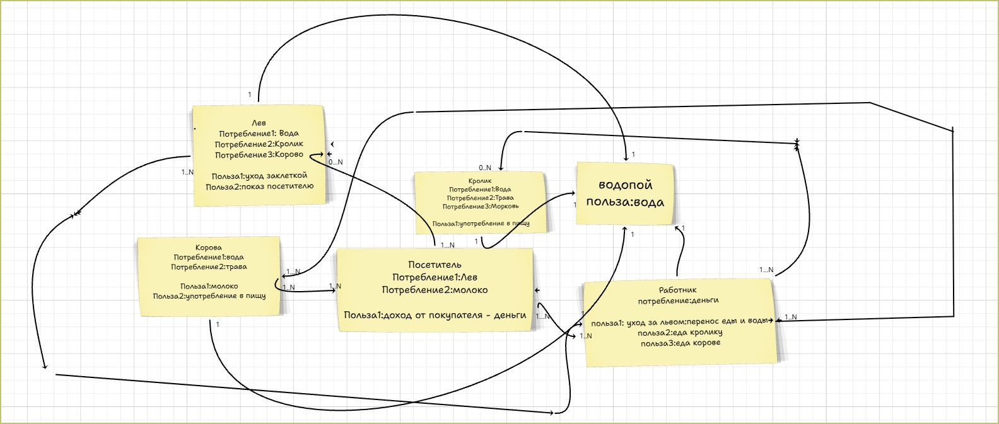

# 10.11.2026

схематичная система работы зоопарка

работник ухаживает за животными, они могут ходить на водопой, корова и кролик служат пищей для льва, который доставляет удовольствие зрителю и он платит деньги работнику